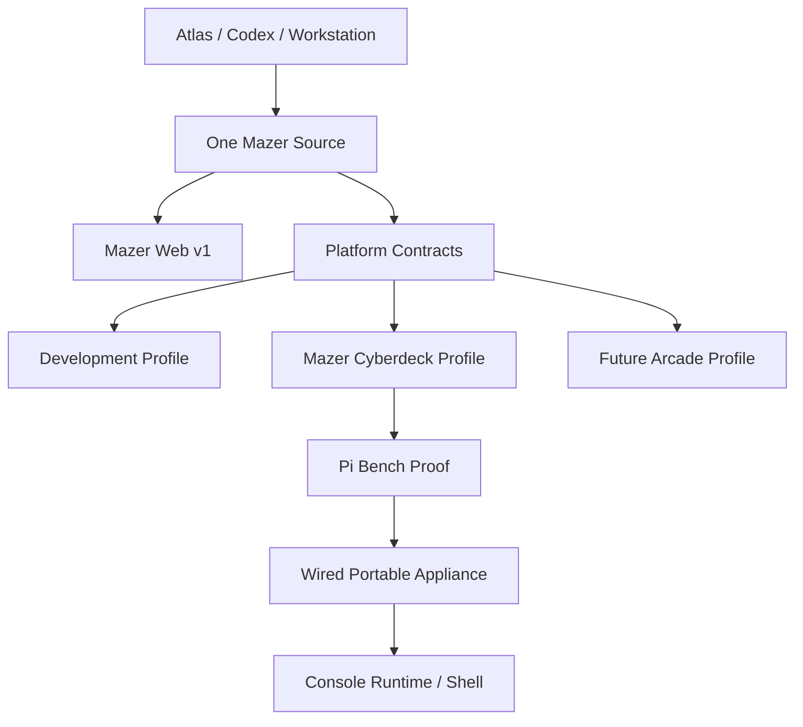
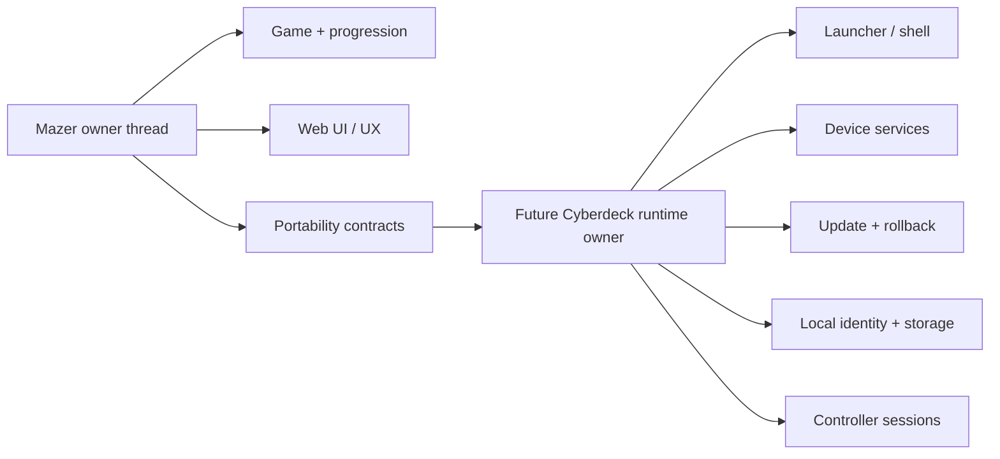
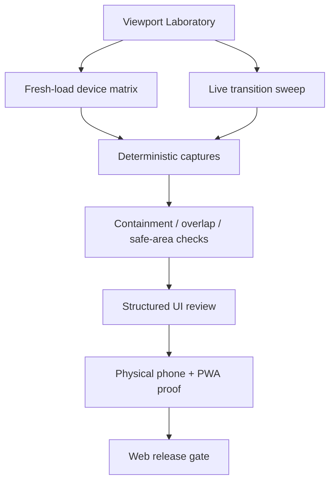
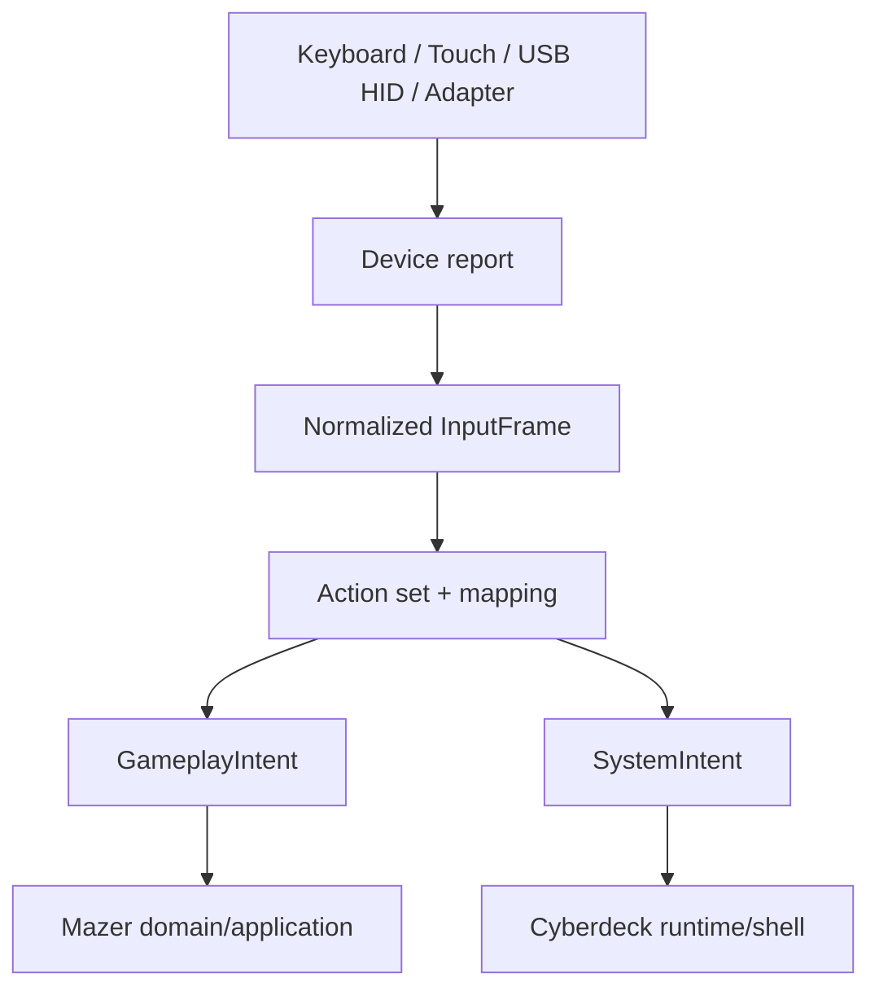
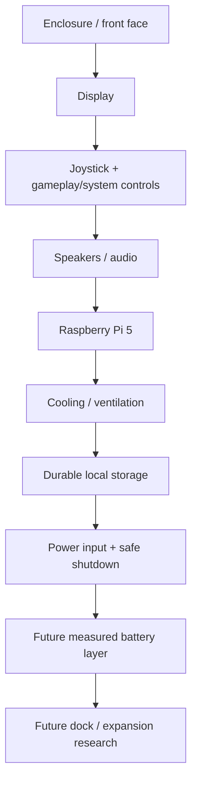

# Mazer Web V1 and Multi-Target Deployment Architecture

Status: canonical planning horizon; no implementation packet is activated by this document.

Drafted: 2026-07-26. Status text refreshed: 2026-11-10 against `origin/main` at
`9980ff28`. The planning content (sequence, decisions, seams, roadmap) is
unchanged from the draft; only repository-state statements were refreshed and a
"Current implementation readback" section was added. Anything this refresh could
not confirm from files on `origin/main` is marked UNKNOWN.

This document consolidates the Web v1, Cyberdeck, development, and future
arcade direction into one architecture and sequencing contract. It does not
change runtime source, tests, PR state, provider state, deployment state, or
board lifecycle.

## Executive sequence

Mazer Web remains the primary active product.

1. Finish and release a genuine Web `1.0.0`.
2. Pass the Web-to-Cyberdeck portability gate.
3. Prove the Cyberdeck profile on a development workstation.
4. Prove a Raspberry Pi bench runtime.
5. Build the wired portable appliance.
6. Add the console runtime/shell, optional connectivity, and controller
   platform in separately admitted packets.
7. Treat commercial arcade work as a future horizon, not a commitment.

Primary Cyberdeck implementation must not bypass Web v1 completion, the
portability gate, or normal packet admission.

Current repository boundaries (read back 2026-11-10 from `origin/main`
`9980ff28` and GitHub PR state via `gh pr view`; superseding the 2026-07-26
readback):

- PR #81 ("fix(ui): clarify compact controls and scroll edges") is MERGED
  (merged 2026-07-26T19:50:26Z, head `47aa4a72`). The draft's "source-review
  clean, still draft" status is obsolete.
- PR #82 ("recover canonical Supabase migration sources") is CLOSED, not merged.
  Its draft-era "owned by the Supabase migration/recovery lane" status is
  obsolete. Why it was closed is UNKNOWN from repository files.
- PR #83 ("feat(auth): add Fitness capability parity") is CLOSED, not merged.
  Its draft-era "held for shared Auth convergence" status is obsolete.
  `docs/roadmap.md` still describes it as "preserved in draft PR #83" and held;
  that roadmap text is stale relative to GitHub and is not changed here.
- The Supabase master cutover is recorded complete in `docs/current-truth.md`
  (production on master project `bxtcuhkotumitoqtrcej`, schema `mazer`; legacy
  project deleted 2026-10-10). The Supabase/Auth ownership boundary that
  previously gated persistence work is therefore no longer an open migration.
  Whether any further shared-Auth convergence is still pending is UNKNOWN.
- The draft's note about a protected pre-existing modification to
  `tests/ai/demo-walker.test.ts` in the canonical checkout described local
  working-tree state, not repository state; it is not asserted here. The test
  file itself exists on `origin/main` and is part of `npm test`.
- Board: `config/mazer-owner-work-registry.json` records
  `MAZER-CYBERDECK-001` as `deferred_candidate` (research retained as planning
  evidence) and `MAZER-DOCS-001` (land this document) as `review`: this document
  is merged (PR #405) but not deployed, and one acceptance item is still open
  (reconcile it with the Cyberdeck research card; `MAZER-CYBERDECK-001` stays a
  dependency). The registry entry is not modified by this document. No
  implementation board card is activated by this planning packet.
- Web v1 is not released: `package.json` is still `"version": "0.1.0"`, and
  `docs/roadmap.md` (Phase order, November 2026) puts finishing Phase 1
  (visuals, progression, flow) before Phase 2 (obstacles and enemies); coins,
  shop, and store entitlements are deferred by direction.

## Decision: one codebase, multiple deployment profiles

One Mazer source revision must be capable of producing all supported target
artifacts. Do not create a separately maintained Cyberdeck fork.

Profiles:

1. **Web** - primary product and current shipping target.
2. **Cyberdeck** - offline-first dedicated appliance.
3. **Development** - local testing, fixtures, and instrumentation.
4. **Future arcade** - venue/commercial extension after the game and device
   are proven.

Target differences belong behind explicit capabilities, route composition,
ports/adapters, and build configuration. Gameplay/domain code must not grow
scattered `if cyberdeck` branches.



## Decision: Cyberdeck is an appliance, not the game becoming an OS

The dedicated Cyberdeck is separate from any future general-purpose laboratory
Raspberry Pi.

- Atlas, Cortex, Codex, source editing, and release orchestration stay on the
  workstation/supporting infrastructure.
- The Raspberry Pi receives and runs a built Mazer artifact.
- "Mazer OS" may be a product-facing name, but v1 should be a minimal Linux
  appliance/runtime rather than a custom Linux distribution.
- The likely first runtime is a local static or Node-backed Mazer service plus a
  kiosk/fullscreen browser, process supervision, health checks, and rollback.
- The actual Vite/Phaser bundle and remote dependency graph must be measured
  before deciding static-only versus local Node service.
- Core play must not require Vercel, FoxyWeb, Socials OS, Supabase, or an
  Internet connection.

The future Cyberdeck runtime thread owns launcher, device settings, local
profiles, input sessions, updates, Wi-Fi, local save/sync queue, and hardware
integration. The Mazer owner thread continues to own gameplay, progression,
Web UI/UX, portability requirements, and compatibility.



## Decision: versioned deployment, not repository synchronization

The device release contract is:

```text
workstation build
  -> versioned Cyberdeck artifact
  -> digest/signature verification
  -> transfer
  -> versioned release directory
  -> atomic active-release switch
  -> service restart
  -> health check
  -> automatic/manual rollback when unhealthy
```

SSH and `rsync` may accelerate early experiments. They are not the final
release contract. The full repository, Atlas state, and development secrets do
not belong on the device.

## Current implementation readback (2026-11-10)

What `origin/main` `9980ff28` actually contains for deployment and targets. Each
line was read from the named file; nothing here was run, built, or checked
against the live provider.

- **Build:** Vite 7 + TypeScript + Phaser 3.90 (`package.json`, `vite.config.ts`).
  `npm run build` runs `scripts/build/run-build.mjs`, which includes
  `scripts/checks/verify-vercelignore-imports.mjs`; `build:raw` is
  `tsc --noEmit && vite build`.
- **Web/PWA target:** `vite-plugin-pwa` emits `app-sw.js` with
  `registerType: 'autoUpdate'`; the manifest is the hand-maintained
  `public/manifest.webmanifest` (`display: standalone`). Service worker
  registration is production-only; `public/sw.js` is a self-unregistering
  retirement worker for the legacy host. See
  `docs/architecture/MAZER-PWA-STRATEGY-AND-BROWSER-MATRIX.md` (marked DRAFT
  there) for the detailed inventory.
- **Hosting:** `vercel.json` sets `git.deploymentEnabled: false` (no deploy from
  Git pushes), permanently redirects `fawxzzy-mazer.vercel.app` to
  `https://mazer.fawxzzy.com/` (excluding `/sw.js`), and rewrites
  `/update-password`, `/privacy`, `/terms` to `/index.html`. Docs record Vercel
  project `fawxzzy-mazer` (`docs/research/MAZER_ORIGINAL_DESIGN_RECOVERY.md`).
  `.vercelignore` keeps `docs/` (except `docs/contracts/`), `tests/`, `legacy/`
  and similar out of the upload. How production deploys are actually executed
  (CLI versus another path) and what is currently deployed are UNKNOWN from
  files; per `AGENTS.md`, production deploy, promotion, and alias changes are
  approval-gated and never implied by this document.
- **CI:** `.github/workflows/verify.yml` ("Verify": every pull request and
  pushes to `main`, Node 22, `npm ci`, `npm run lint`, then file-listed vitest
  suites and later steps) and `.github/workflows/ci.yml` ("Owner export": path
  filtered, deterministic project-board export check). Neither workflow
  deploys.
- **Capability seam:** `docs/contracts/mazer-ui-rework-platform-profiles.v1.json`
  registers seven profiles (`web`, `mobile`, `desktop`, `tv`, `obs`, `arcade`,
  `cyberdeck`), mirrored by `src/state/uiProfiles.ts` and checked by
  `scripts/check-ui-platform-profiles.mjs`. At runtime, `MenuScene` selects only
  `mobile` (when `navigator.maxTouchPoints > 0`) or `web`
  (`resolveUiPlatformProfile`). No other profile is selectable, there is no
  Cyberdeck build target, and no route composition by profile exists. This is
  the Wave 2 foundation in registry form only. The registry's `cyberdeck` row
  (auth optional, sync optional) is a looser capability declaration than this
  document's Cyberdeck column (no accounts); reconciling them belongs to the
  admitted platform-profile packet.
- **Native shell:** no Capacitor, Cordova, Tauri, or Electron dependency or
  config exists in `package.json`, `src`, or `scripts`. Capacitor is described
  only as a later option in `docs/mobile-plan.md`; store packaging is
  unstarted.
- **Cyberdeck/arcade:** no Raspberry Pi, kiosk, device-release, or controller
  adapter code was found in `src`, `scripts`, or `package.json` (a search for
  `cyberdeck` in `src`, `scripts`, `tests`, and `package.json` found only
  `src/state/uiProfiles.ts` and `scripts/check-ui-platform-profiles.mjs`).
  Everything in the Cyberdeck, Pi, and arcade columns of this document remains
  planning only.
- **Sibling research doc:** `docs/research/MAZER_WEB_V1_CYBERDECK_CANONICAL_DEEP_RESEARCH.md`
  already on `main` names this document as its "Canonical architecture
  synthesis"; until this document lands that reference is dangling
  (`docs/research/MAZER_ECONOMY_AND_ENTITLEMENT_CONTRACT_DRAFT.md` records the
  same open question).

## Web v1 product gate

Web v1 must be release quality before primary Cyberdeck implementation starts.
The planning budget is deliberately bounded:

- one single-player mode;
- three enemy archetypes;
- four item types;
- one earned currency;
- twelve earned cosmetics.

These counts are product planning limits, not claims that the features already
ship. As of 2026-11-10, `docs/current-truth.md` records that live play contains
no non-player/non-goal gameplay object, and `docs/roadmap.md` defers obstacles
and enemies to Phase 2 and the shop and store entitlements by direction. Those
documents remain runtime truth until separately admitted implementation proves
otherwise.

The planned commercial entitlement is a one-time USD $5 Mazer entitlement tied
to the immutable shared user identity, never to a mutable email string. This is
a product contract only:

- it does not unlock the deferred Stripe/payment lane;
- the client never authors entitlement truth;
- no schema, provider, price, checkout, or production mutation is authorized;
- `docs/MAZER_SUPABASE_STORAGE.md` remains the current data-boundary contract.

Entitlement, payment, and purchase code in `src` was not searched during the
2026-11-10 refresh; whether any exists is UNKNOWN.

## Responsive equivalence and viewport-proof model

Responsive equivalence means consistent hierarchy, capability, readability,
input reliability, and gameplay semantics. It does not mean identical pixels
at every size.

Two complementary proof modes are required:

1. **Fresh-load matrix**
   - named desktop, tablet, and phone profiles;
   - viewport, screen size, user agent, touch, scale factor, and orientation;
   - deterministic captures per route/surface.
2. **Live-transition sweep**
   - width/height continuum;
   - breakpoint-minus-one and breakpoint-plus-one;
   - narrow portrait, wide portrait, short landscape, and unusual tablet
     shapes;
   - resize, maximize/restore, orientation change, keyboard open/close, and
     overlay/scroll transitions.

Desktop viewport automation is necessary but cannot replace real mobile and
installed-PWA proof. Mobile browsers have distinct layout and visual viewports;
the on-screen keyboard can shrink the visual viewport without changing the
layout viewport.

Required surface families:

- install;
- login and signup;
- purchase and entitlement gate;
- account;
- main menu;
- gameplay and maximum-size maze;
- pause;
- results;
- tutorial;
- shop/customization;
- offline and error states.



## Platform capability matrix

| Capability | Web | Cyberdeck | Development | Future arcade |
|---|---|---|---|---|
| Authenticated accounts | Yes | No | Configurable | Normally no |
| Account UI | Yes | No | Configurable | No |
| Cloud persistence | Yes | Optional future | Configurable | Optional |
| Local persistence | Browser/cache as applicable | Required | Required for tests | Required |
| Offline core play | Desired | Required | Required for tests | Required |
| Automatic local profile | No | Yes | Configurable | Yes |
| Reset progression | Account-safe reset | Local reset | Test reset | Operator/session reset |
| Keyboard input | Yes | Optional/service | Yes | Service only |
| Touch input | Yes | Optional | Yes | Usually no |
| Arcade joystick/button | Optional | Required | Emulated | Required |
| Browser chrome visible | Normal web context | No | Allowed | No |
| Auto-launch on boot | No | Required | No | Required |
| FoxyWeb dependency | Optional integration | None | None | None |
| Socials OS dependency | None for gameplay | None | None | None |
| Internet requirement | Account features may require it | None for core play | None | None for core play |
| Update mechanism | Web deployment (Vercel; service-worker auto-update) | Versioned device release | Local development | Operator-controlled release |

## Platform contract seams

The target shape is ports/adapters around shared domain and application logic.
Existing stronger repository terms win where they already exist.

### Shared domain

- progression;
- scoring and run quality;
- rank and achievements;
- level state;
- movement and maze rules;
- reset-progression semantics.

### Application layer

- start/resume run;
- load/save;
- reset progression;
- input-intent handling;
- profile-aware navigation.

### Platform contracts

- identity provider;
- progression repository;
- input adapter;
- route manifest;
- capability provider;
- telemetry provider;
- clock/runtime provider where needed.

### Infrastructure adapters

- Web/Supabase persistence;
- local Cyberdeck persistence;
- development fixtures;
- browser keyboard/touch/Gamepad input;
- USB HID arcade controls;
- device runtime and release services.

## Identity, persistence, and reset semantics

Web and Cyberdeck identity are intentionally different:

- Web uses the shared authenticated account when that platform contract is
  available.
- Cyberdeck v1 automatically creates/selects a local cabinet/player identity.
- Cyberdeck omits login, registration, password recovery, cloud account
  management, and cloud-only sync routes through profile route composition.

Progression rules stay shared. Persistence is profile-specific:

- Web/cloud progression repository;
- Cyberdeck/local progression repository;
- development/test progression repository.

Reset progression is a shared domain operation, not account deletion:

- **Web:** keep the account/session, require strong confirmation, reset through
  the authoritative server path, and record an auditable result.
- **Cyberdeck:** keep local identity, reset local progression, and expose the
  command only through a deliberate service/protected flow.

No reset or persistence implementation is admitted by this document. As of
2026-11-10 the Supabase master cutover is recorded complete (see Current
repository boundaries), but implementation still requires its own admitted
packet naming database/Auth impact.

## Input architecture and logical Cyberdeck Controller Bus

Gameplay consumes semantic intents, not browser events, GPIO pins, keycodes, or
controller brands.

The stable pipeline is:



The conceptual `InputFrame` must preserve raw independent state before policy
resolution:

```text
InputFrame
- monotonic timestamp / sequence
- source and connection identity
- independent up/down/left/right digital state
- normalized axes
- button values and pressed state
- active action-set/mapping identity
```

Rules:

- Preserve simultaneous independent directions before resolving movement
  policy.
- Poll gameplay state on the render/update cadence; use connect/disconnect
  events for lifecycle, not as the only source of state.
- Apply dead zones, hysteresis, diagonal/turn policy, and repeat behavior after
  normalization.
- Keep gameplay and system intents separate.
- Do not assume generic controller button indexes always map identically.

The Cyberdeck Controller Bus (CCB) is logical before physical:

1. **CCB v0:** versioned descriptor, report, mapping, and action-set contract.
2. **CCB v1:** standard USB HID controllers and arcade encoders.
3. **CCB v2:** Pico 2/RP2350 retro and custom controller adapters.
4. **CCB v3:** magnetic/pogo transport research only after electrical,
   mechanical, safety, and durability proof.
5. **CCB v4:** custom controller/base PCBs only after the protocol and product
   dimensions stabilize.

Pico 2 is an adapter stage, not the universal first-generation controller host.
If exact independent directional parity matters, evaluate keyboard HID,
button-based gamepad directions, or a custom HID descriptor instead of assuming
a single hat-switch report preserves every combination.

## Cyberdeck runtime acceptance horizon

A future device proof must demonstrate:

- cold boot directly into Mazer;
- no visible Linux desktop or browser chrome;
- no login/account-management UI;
- automatic local identity;
- offline core play and durable local progression;
- joystick and required button input;
- deliberate reset-progress path;
- safe shutdown/power-loss mitigation;
- automatic process restart;
- operator-visible health and version;
- versioned update and rollback;
- no production service-role keys or unnecessary secrets;
- no dependency on the workstation after installation.

Power-loss resilience must be measured. Candidate protections include atomic
writes, journaling, backup snapshots, checksums, and recovery from interrupted
writes. SD-card persistence is not assumed safe merely because it works once.

## Hardware and purchase gates

The provisional prototype budget remains USD $350-$650. It is a planning range,
not purchase authority or a final bill of materials.

Use Raspberry Pi 5 for the first bench and wired-portable proofs. Consider
Compute Module 5 only after carrier-board freedom, embedded storage, or tighter
integration becomes an evidenced need.



| Gate | Buy class | Examples | Deferred until later |
|---|---|---|---|
| Reusable lab setup | Hand tools and safety | drivers, multimeter, cutters, calipers, mat, storage | expensive specialty tools |
| Portability gate passed | Bench proof | Pi 5, correct PSU, cooling, storage, display cable | battery, dock, custom PCB |
| Pi runtime proven | Wired portable | display, joystick, encoder, speakers, enclosure materials | final carrier board |
| Soak/thermal proof passed | Robustness | panel ports, final harness, shutdown control, improved audio | unmeasured battery |
| Measured power study passed | Battery/dock | certified power solution, charge/status path, dock wiring | speculative custom transport |
| Stable software/protocol/dimensions | Custom hardware | carrier/controller PCB, premium fabrication | premature volume production |

Raspberry Pi 5 power and downstream USB budgets vary with the supply, so final
power, battery, and dock choices require measurement of the actual display,
audio, controller, cooling, and storage configuration.

## Staged roadmap

### Wave 0 - Canonical planning ingestion

- Maintain this architecture, capability matrix, packet register, and risks.
- Do not activate implementation or a board card.

### Wave 1 - Web v1 and portability inventory

- Finish the bounded Web v1 product.
- Inventory web-only coupling in Auth, navigation, persistence, input, runtime,
  and deployment.
- Prevent new domain logic from becoming browser/Supabase-specific.
- PR #81 has since merged (2026-07-26); it no longer gates primary Cyberdeck
  implementation. Web v1 completion and the portability gate still do.

### Wave 2 - Platform-profile foundation

- capability provider;
- target route composition;
- profile configuration;
- development profile;
- tests proving unchanged Web behavior.

### Wave 3 - Progression and local persistence

- shared progression repository contract;
- Web and local adapters;
- automatic local identity;
- shared reset-progress command and profile-specific UX;
- compatibility and migration proof.

This wave originally waited for compatible Supabase/Auth ownership. The
2026-10 master cutover is recorded complete in `docs/current-truth.md`; the wave
still requires explicit packet admission, and any remaining Auth-convergence
dependency is UNKNOWN.

### Wave 4 - Pi and arcade-input proof

- standard USB HID/encoder adapter;
- ARM/Linux runtime decision;
- local server/static artifact decision;
- kiosk boot;
- offline proof;
- measured input latency and missed-input behavior.

### Wave 5 - Device deployment/runtime

- versioned packaging and installation;
- health check, supervision, and rollback;
- update and service access;
- repeated power-cycle and interrupted-save proof.

### Wave 6 - Physical portable product

- final display, controls, audio, cooling, power, enclosure, and wiring;
- thermal and endurance testing;
- deliberate service access without normal-player exposure.

### Wave 7 - Electrical-engineering extensions

- direct GPIO;
- debounce circuits;
- microcontroller input coprocessor;
- custom controller PCB;
- improved power management;
- battery operation if justified;
- instrumentation and measurements.

### Wave 8 - Future arcade/business horizon

- attract mode;
- local high-score board;
- free-play/session reset;
- operator service menu;
- commercial controls and recovery;
- accessibility, electrical, enclosure, legal, insurance, tax, and
  revenue-share analysis.

Coin/payment hardware and commercial commitments are outside current Cyberdeck
scope.

## Candidate packet register

These are recorded, not activated.

| Packet | Dependencies | Safe during Supabase migration? | Physical hardware? | Core verification |
|---|---|---:|---:|---|
| Platform-coupling inventory | current architecture (PR #81 settled; merged) | Yes, read/source-only | No | coupling denominator and Web invariance |
| Capability and route composition | inventory; explicit admission | Yes if Auth routes are not behaviorally changed | No | profile/route matrix and Web regression |
| Shared progression repository | platform profile; Auth/data clearance | No | No | semantic parity and migration proof |
| Local identity and persistence | progression contract | Partially; local-only prototype after exact admission | No | zero-to-head local save/recovery |
| Reset-progression command | persistence contracts | No for Web; local-only can be isolated | No | shared semantics and per-profile confirmation |
| Arcade-input adapter | stable controls; `InputFrame` contract | Yes | Optional | deterministic input parity and latency |
| Pi kiosk/runtime proof | profile foundation; build characterization | Yes if fully local | Yes | boot/offline/restart/health proof |
| Device release pipeline | Pi runtime proof | Yes if device-local | Yes | digest/install/rollback/replay |
| Hardware/BOM/enclosure | runtime, thermal, and power measurements | Yes | Yes | fit, thermal, electrical, endurance |
| Commercial arcade feasibility | stable Cyberdeck | Yes, research-only | Maybe | cost/legal/operator evidence |

Each admitted packet must name owner, files/surfaces, base, dependencies,
conflicts, database/Auth impact, proof, rollback, and physical-hardware need.

## Project-book and visual-packet structure

The durable planning packet should render cleanly as the following paper/digital
project-book sequence:

1. product family and sequencing map;
2. Mazer versus Cyberdeck-runtime ownership map;
3. Web v1 product gate and bounded content/entitlement contracts;
4. responsive viewport laboratory and release proof;
5. platform capability matrix;
6. shared-domain and adapter architecture;
7. identity, persistence, and reset semantics;
8. normalized input and logical Controller Bus;
9. exploded Cyberdeck hardware stack;
10. staged roadmap and purchase gates;
11. candidate implementation packet register;
12. risks, unknowns, evidence, and acceptance gates.

This document is the canonical source for that visual packet. Derived slides,
posters, PDFs, or project-book pages must link back to it rather than becoming
independent decision sources.

## Risks and unknowns

- Current bundle/runtime behavior on ARM Linux is unmeasured.
- Static-only versus local Node service is unresolved.
- Offline save integrity and power-loss recovery are unproven.
- Exact Web v1 content readiness against the bounded budget is unmeasured.
- The $5 product entitlement is planned but provider/payment implementation is
  held.
- Gamepad mappings vary across controller/platform combinations.
- Hat-switch reports may lose independent directional combinations.
- Input latency/missed-input behavior needs hardware measurement.
- Display dimensions, thermals, acoustic output, peripheral current, and power
  draw are unknown.
- Battery, dock, and magnetic/pogo transport remain research.
- Commercial viability is unvalidated.

## Architecture failure modes

- **Forked target:** a separate Cyberdeck game diverges from Web.
- **Conditional sprawl:** scattered target checks create hidden applications.
- **Repo synchronization:** device state becomes non-reproducible and leaks
  development material.
- **Cloud-coupled core:** offline play fails when platform services are down.
- **Identity conflation:** local cabinet identity is treated as a cloud account.
- **Persistence duplication:** progression rules drift between storage adapters.
- **Hardware-first design:** enclosure/electronics freeze before runtime,
  control, thermal, and power proof.
- **Desktop-only UI proof:** real mobile keyboard/safe-area failures escape.
- **Hat-switch information loss:** raw directional combinations disappear
  before policy resolution.

## Reusable rules and decisions

- **Rule:** Core game rules never know which deployment profile is active.
- **Pattern:** Isolate identity, storage, input, navigation, telemetry, and
  runtime behind platform contracts and adapters.
- **Decision:** Cyberdeck is a dedicated Mazer appliance; the engineering lab
  uses separate hardware.
- **Decision:** Atlas/Codex are the development plane; the Pi is the execution
  plane.
- **Decision:** Release artifacts are versioned, verified, health-checked, and
  rollback-capable.
- **Decision:** Responsive equivalence requires both viewport-lab automation and
  physical mobile/PWA proof.
- **Decision:** CCB is logical-first, USB-HID-first, and custom-physical-later.

## Research sources

Primary references used to validate planning assumptions:

- [Playwright emulation](https://playwright.dev/docs/emulation) - device
  descriptors and explicit viewport configuration.
- [MDN VisualViewport](https://developer.mozilla.org/en-US/docs/Web/API/VisualViewport)
  - layout versus visual viewport and on-screen keyboard behavior.
- [MDN Gamepad](https://developer.mozilla.org/en-US/docs/Web/API/Gamepad) and
  [Using the Gamepad API](https://developer.mozilla.org/en-US/docs/Web/API/Gamepad_API/Using_the_Gamepad_API)
  - buttons, axes, timestamps, lifecycle, and sampled state.
- [Raspberry Pi 5](https://www.raspberrypi.com/products/raspberry-pi-5/) and
  [Raspberry Pi hardware documentation](https://www.raspberrypi.com/documentation/computers/raspberry-pi.html)
  - Pi 5 connectivity and power/peripheral limits.
- [Compute Module documentation](https://www.raspberrypi.com/documentation/computers/compute-module.html)
  - CM5 variants and carrier-board role.
- [RP2350](https://www.raspberrypi.com/products/rp2350/) - Pico 2-class USB
  host/device and microcontroller capabilities.
- [TinyUSB HID composite example](https://docs.tinyusb.org/en/latest/examples/device/hid_composite.html)
  - standard composite HID/gamepad report precedent.

## Verification posture

This is documentation-only planning ingestion.

- No runtime behavior or source code changed.
- No test/build result is claimed by this document.
- No PR, board, provider, Supabase/Auth, Vercel, production, or hardware action
  is authorized.
- Implementation truth remains governed by `docs/current-truth.md`, admitted
  packet evidence, and exact Git/provider readback.
- The 2026-11-10 refresh was a read-only comparison of the draft against
  `origin/main` `9980ff28` and `gh pr view` output for #81-#83; no build, test,
  deployment, or live-site check was run for it.
